# VisionGuard: AI vs Real Image Classification and Deployment
## MLOps Assignment 2 — Comprehensive Project Report

---

### Student & Submission Metadata

- **Student Name:** `[INSERT STUDENT NAME]`
- **Student ID:** `[INSERT STUDENT ID]`
- **Course Title:** MLOps (Machine Learning Operations)
- **Assignment:** Assignment 2 — End-to-End Image Classification and Deployment
- **Project Title:** VisionGuard: AI vs Real Image Classification and Deployment
- **Dataset:** Kaggle `cashbowman/ai-generated-images-vs-real-images`
- **Submission Date:** `[INSERT SUBMISSION DATE]`

---

### Key Project & Artifact Links

- **GitHub Repository URL:** `[INSERT GITHUB REPOSITORY URL]`
- **DagsHub Repository URL:** `[INSERT DAGSHUB REPOSITORY URL]`
- **Public Cloud Model API URL:** `[INSERT HOSTED MODEL API URL]`
- **Web Application Live URL:** `[INSERT WEB APPLICATION URL (IF APPLICABLE)]`
- **Docker Hub Repository URL:** `[INSERT DOCKER HUB REPOSITORY URL]`
- **MLflow Tracking URI:** `[INSERT DAGSHUB MLFLOW TRACKING URI]`

---

## Task 1: Environment, Dataset Audit, Visual EDA, and DVC

### Subtask 1.1: Local Workspace and Environment Verification
- **Objective:** Configure project workspace, set up Python 3.11 virtual environment, and verify package dependencies without system crashes.
- **Methodology:**
  - Execute diagnostic script `scripts/check_environment.py` to inspect runtime environment, virtual environment activation, platform build, package versions, and hardware acceleration (TensorFlow CPU/GPU detection).
- **Execution Command:**
  ```powershell
  python scripts/check_environment.py
  ```
- **Observed Environment Details:**
  - Python Version: `[TBD: Output from check_environment.py]`
  - Python Executable: `[TBD: Virtual environment path]`
  - Operating System: `[TBD: Windows build]`
  - Core Packages (NumPy, Pandas, Matplotlib, Pillow, Scikit-learn): `[TBD: Versions]`
  - Deep Learning Framework (TensorFlow & GPU status): `[TBD: CPU/GPU status]`
- **Screenshots & Evidence:**
  - *Figure 1.1:* Environment verification script execution
    ```text
    
    ```
    *Caption:* Output from `python scripts/check_environment.py` displaying Python 3.11, active virtual environment, and dependency availability.

---

### Subtask 1.2: Dataset Audit (`cashbowman/ai-generated-images-vs-real-images`)
- **Objective:** Recursively inspect raw dataset files to verify image integrity, check format consistency, detect unreadable/corrupt files, identify exact duplicates (via SHA-256), and compute dimensional statistics.
- **Methodology:**
  - Run `scripts/audit_dataset.py` traversing `data/raw/`.
  - For each image: compute SHA-256 hash, measure file size, decode image headers with Pillow, perform two-pass load verification to confirm pixel decompression integrity, and extract width, height, aspect ratio, and color mode.
  - Export full audit data to `reports/dataset_audit_details.csv` and summary statistics to `reports/dataset_audit_summary.json`.
- **Execution Command:**
  ```powershell
  python scripts/audit_dataset.py --data-dir data/raw --output-dir reports
  ```
- **Dataset Audit Findings:**
  - Total Files Audited: `[TBD: Run audit_dataset.py]`
  - Valid Readable Images: `[TBD: Run audit_dataset.py]`
  - Corrupt / Unreadable Images: `[TBD: Run audit_dataset.py]`
  - Duplicate Files (Identical SHA-256): `[TBD: Run audit_dataset.py]`
  - Unique SHA-256 Hashes: `[TBD: Run audit_dataset.py]`
  - Image Formats Detected: `[TBD: e.g. JPEG, PNG]`
  - Color Modes Detected: `[TBD: e.g. RGB]`
- **Per-Class Metrics Table:**
  | Metric / Property | AI-Generated Class | Real Images Class |
  | :--- | :---: | :---: |
  | **Total Files Count** | `[TBD]` | `[TBD]` |
  | **Valid Image Count** | `[TBD]` | `[TBD]` |
  | **Corrupted Images** | `[TBD]` | `[TBD]` |
  | **Duplicate Images** | `[TBD]` | `[TBD]` |
  | **Width (Min / Median / Max px)** | `[TBD]` | `[TBD]` |
  | **Height (Min / Median / Max px)** | `[TBD]` | `[TBD]` |
  | **File Size (Min / Median / Max KB)**| `[TBD]` | `[TBD]` |
- **Screenshots & Evidence:**
  - *Figure 1.2:* Dataset audit script execution log
    ```text
    
    ```
    *Caption:* Execution log of `scripts/audit_dataset.py` showing class distribution, duplicate counts, and file integrity metrics.

---

### Subtask 1.3: Visual Exploratory Data Analysis (EDA)
- **Objective:** Generate visual distributions, compare class balances, examine dimension histograms, and inspect balanced image grids to analyze visual characteristics of AI-generated versus real images.
- **Methodology:**
  - Run `scripts/visualize_dataset.py` reading from `reports/dataset_audit_details.csv`.
  - Produce:
    1. Balanced sample grid comparing Real and AI images with dimensions and file size.
    2. Class balance and file integrity comparison bar chart.
    3. Width and height distribution comparative histograms.
    4. File size distribution histogram.
    5. Quantitative markdown summary in `reports/task1_3_eda_summary.md`.
- **Execution Command:**
  ```powershell
  python scripts/visualize_dataset.py --data-dir data/raw --audit-csv reports/dataset_audit_details.csv --output-dir reports/figures
  ```
- **Visual Observations & Qualitative Notes:**
  - `[Document specific visual artifacts observed in AI images: e.g. edge unnaturalness, blurriness in complex patterns, symmetry anomalies]`
  - `[Document resolution distributions and implications for CNN input resizing (e.g. 224x224 target)]`
- **Screenshots & Figures:**
  - *Figure 1.3a:* Visual comparison grid of AI vs Real images
    ```text
    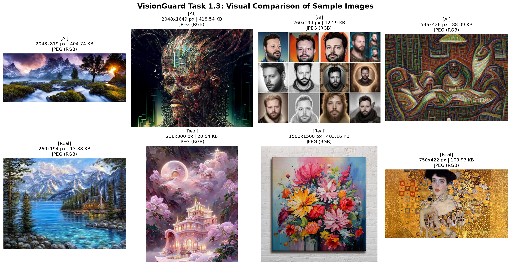
    ```
    *Caption:* Grid of sample images from both classes with dimensions, file sizes, and color modes.
  - *Figure 1.3b:* Class balance and integrity chart
    ```text
    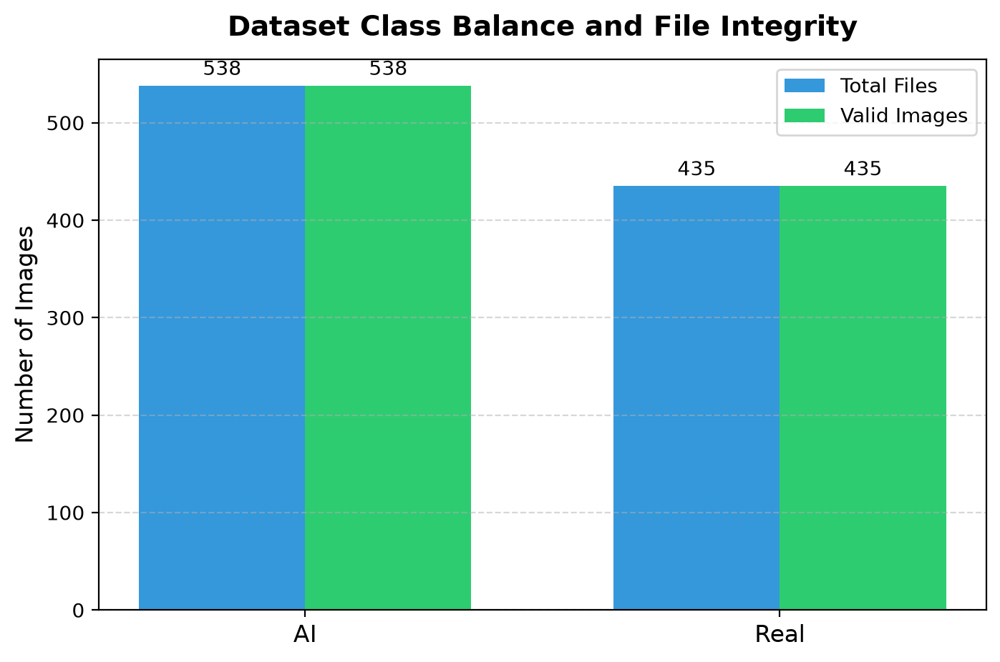
    ```
    *Caption:* Class count distribution comparing total vs valid files.
  - *Figure 1.3c:* Image width and height distributions
    ```text
    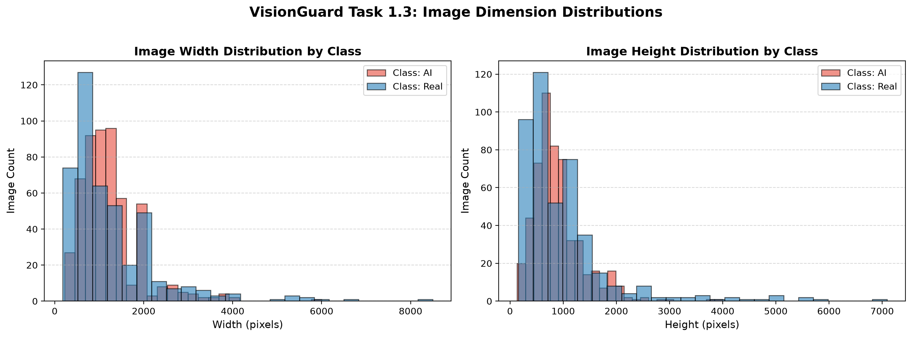
    ```
    *Caption:* Comparative histograms of image widths and heights across classes.
  - *Figure 1.3d:* Image file size distributions
    ```text
    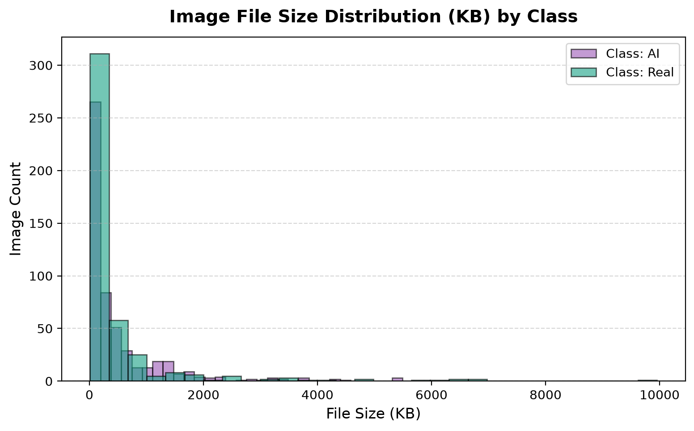
    ```
    *Caption:* Histogram of image file sizes in KB for Real and AI-generated subsets.

---

### Subtask 1.4: DVC Tracking and Remote Storage Configuration
- **Objective:** Initialize DVC, track raw dataset directories (`data/raw/`), configure DagsHub remote storage, and ensure pointer files are tracked by Git while large data binaries are ignored.
- **Methodology:**
  - Initialize Git and DVC in workspace root.
  - Configure DagsHub remote endpoint using DVC HTTP remote protocol.
  - Track raw dataset directory using `dvc add data/raw`.
  - Commit pointer file (`data/raw.dvc`) and `.gitignore` rules to Git.
  - Push data artifacts to DagsHub remote using `dvc push`.
- **Execution Commands:**
  ```powershell
  git init
  dvc init
  dvc remote add -d origin https://dagshub.com/<USERNAME>/VisionGuard.dvc
  dvc remote modify origin --local auth basic
  dvc remote modify origin --local user <USERNAME>
  dvc remote modify origin --local password <TOKEN>
  dvc add data/raw
  git add .gitignore data/raw.dvc .dvc/config
  git commit -m "Task 1.4: Track raw dataset with DVC and configure DagsHub remote"
  dvc push
  ```
- **Screenshots & Evidence:**
  - *Figure 1.4:* DVC remote tracking on DagsHub
    ```text
    
    ```
    *Caption:* DagsHub storage dashboard verifying tracked raw dataset via DVC.

---

## Task 2: TensorFlow/Keras Model Development, Custom CNN, Transfer Learning, Evaluation, Error Analysis, Keras Tuner, and Optional Grad-CAM

### Subtask 2.1: Data Preprocessing, Augmentation, and Input Pipeline
- **Objective:** Implement reproducible Train/Validation/Test data splitting (70/15/15), image decoding, resizing (224x224), batching, prefetching, and training-only data augmentation.
- **Methodology & Module:**
  - Built modular pipeline in `src/data/pipeline.py`.
  - Applied stratified split on `data/raw/AiArtData` and `data/raw/RealArt` with seed=42.
  - Training augmentation includes `RandomFlip`, `RandomRotation`, `RandomZoom`, and `RandomContrast`.
  - Extracted sample training batch to verify augmentation visual evidence.
- **Execution Command:**
  ```powershell
  python scripts/run_task2.py
  ```
- **Screenshots & Evidence:**
  - *Figure 2.1:* Augmented training batch visualization
    ```text
    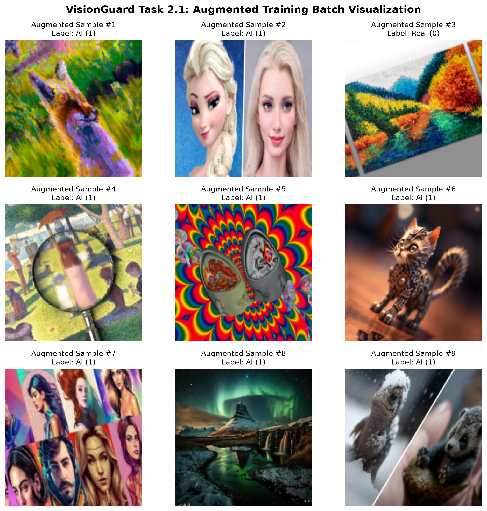
    ```
    *Caption:* Grid of 9 augmented training samples displaying transformed images, inferred class labels, and tensor indices.

---

### Subtask 2.2: Custom CNN Architecture Design & Training
- **Objective:** Construct a lightweight Custom CNN from scratch, compile with Adam and binary crossentropy, print parameter summary, export parameter CSV, and train with checkpointing and early stopping.
- **Methodology & Module:**
  - Implemented in `src/models/custom_cnn.py`.
  - Architecture: Rescaling(1/255) -> 4x [Conv2D + BatchNormalization + MaxPooling2D] -> GlobalAveragePooling2D -> Dense(128) -> Dropout(0.4) -> Dense(1, Sigmoid).
  - Parameter table exported to `reports/task2_2_cnn_params.csv`.
  - Trained using `ModelCheckpoint` (monitoring val_loss), `ReduceLROnPlateau`, and `EarlyStopping`.
- **Screenshots & Evidence:**
  - *Figure 2.2:* Custom CNN training history curves
    ```text
    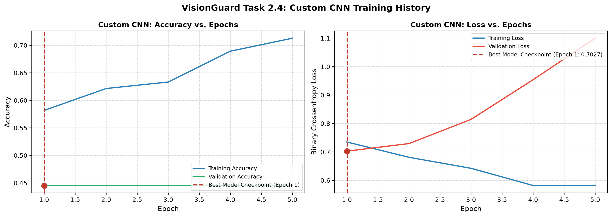
    ```
    *Caption:* Training vs validation accuracy and loss curves for Custom CNN with dashed line indicating the best checkpoint epoch.

---

### Subtask 2.3: Transfer Learning using Keras Applications (MobileNetV2)
- **Objective:** Implement transfer learning with pre-trained MobileNetV2 backbone. Phase 1: feature extraction (backbone frozen). Phase 2: fine-tuning (top 30 layers unfrozen, reduced learning rate).
- **Methodology & Module:**
  - Implemented in `src/models/transfer_model.py`.
  - Embedded native `mobilenet_v2.preprocess_input`.
  - Audited and printed trainable layer lists before and after unfreezing in terminal.
  - Saved combined initial and fine-tuning history curves with phase boundary and best checkpoint marker.
- **Screenshots & Evidence:**
  - *Figure 2.3:* Combined Transfer Learning training and fine-tuning curves
    ```text
    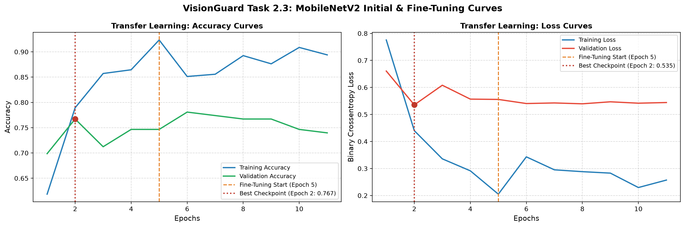
    ```
    *Caption:* Accuracy and loss trajectories across feature extraction and fine-tuning phases, with markers for fine-tuning start and the best saved checkpoint.

---

### Subtask 2.4: Comprehensive Model Evaluation (Custom CNN vs Transfer Learning)
- **Objective:** Quantitatively evaluate both trained models against the unseen test split using Accuracy, Precision, Recall, F1-Score, and ROC-AUC.
- **Methodology & Module:**
  - Implemented in `src/evaluation/metrics.py`.
  - Generated comparison table in terminal and exported to `reports/task2_model_comparison.csv`.
  - Plotted side-by-side Confusion Matrices and comparative ROC curves with AUC annotations.
- **Model Evaluation Comparison Table:**
  | Metric | Custom CNN Model | MobileNetV2 Transfer Learning |
  | :--- | :---: | :---: |
  | **Accuracy** | `[TBD: Run scripts/run_task2.py]` | `[TBD: Run scripts/run_task2.py]` |
  | **Precision** | `[TBD: Run scripts/run_task2.py]` | `[TBD: Run scripts/run_task2.py]` |
  | **Recall** | `[TBD: Run scripts/run_task2.py]` | `[TBD: Run scripts/run_task2.py]` |
  | **F1-Score** | `[TBD: Run scripts/run_task2.py]` | `[TBD: Run scripts/run_task2.py]` |
  | **ROC-AUC** | `[TBD: Run scripts/run_task2.py]` | `[TBD: Run scripts/run_task2.py]` |
- **Screenshots & Evidence:**
  - *Figure 2.4a:* Side-by-side Confusion Matrices
    ```text
    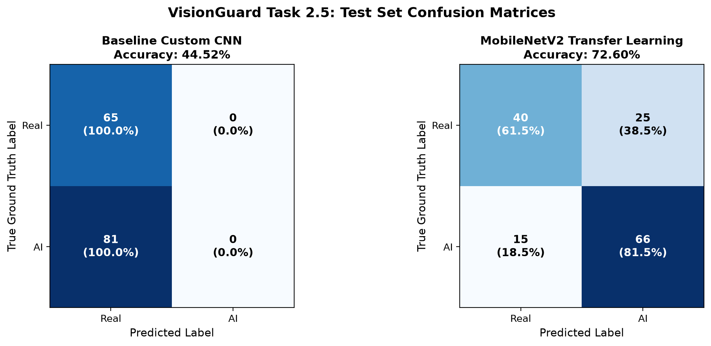
    ```
    *Caption:* Normalized confusion matrix heatmaps comparing Custom CNN and MobileNetV2 on the test set.
  - *Figure 2.4b:* Comparative ROC Curves
    ```text
    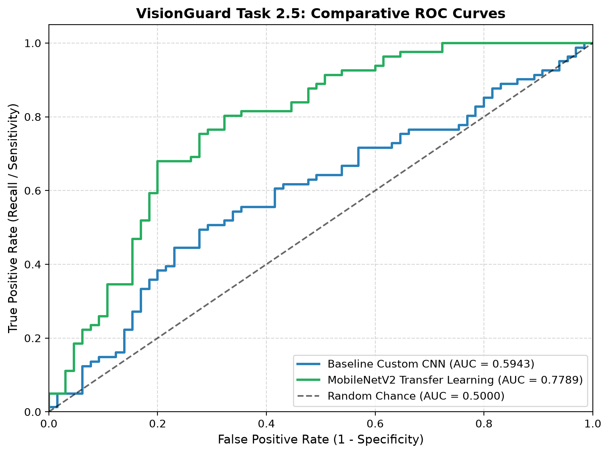
    ```
    *Caption:* Comparative Receiver Operating Characteristic (ROC) curves with AUC metrics for both models.

---

### Subtask 2.5: Qualitative Error Analysis
- **Objective:** Inspect test set failure cases (false positives and false negatives) from the best performing model to identify common visual error patterns.
- **Methodology & Module:**
  - Implemented in `src/evaluation/metrics.py`.
  - Isolated test misclassifications sorted by prediction confidence.
  - Rendered a grid of 10 misclassified images displaying true class, predicted label, confidence score, and filename.
- **Screenshots & Evidence:**
  - *Figure 2.5:* Qualitative error analysis image grid
    ```text
    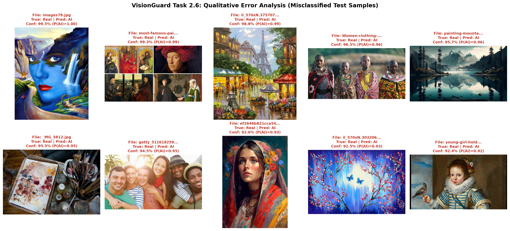
    ```
    *Caption:* Gallery of 10 misclassified test images showing true label, predicted label, confidence score, and image filename.

---

### Subtask 2.6: Hyperparameter Tuning with Keras Tuner
- **Objective:** Demonstrate hyperparameter tuning both on a toy benchmark dataset and applied to VisionGuard transfer learning.
- **Evidence Gen 1 (Toy Search):**
  - Script: `scripts/run_tuner_toy.py`
  - Tunes dense units and learning rate on Fashion-MNIST dataset.
  - Results exported to `reports/task2_7_tuner_toy_results.csv`.
  - Execution Command:
    ```powershell
    python scripts/run_tuner_toy.py
    ```
- **Evidence Gen 2 (Applied Search):**
  - Script: `scripts/run_tuner.py`
  - Tunes learning rate, dropout rate, and unfrozen backbone layers across 8 trials on the VisionGuard dataset.
  - Results exported to `reports/task2_7_tuner_visionguard_results.csv`.
  - Execution Command:
    ```powershell
    python scripts/run_tuner.py --max-trials 8 --epochs 3
    ```
- **Optimal Hyperparameters Summary Table:**
  | Hyperparameter | Search Space Range | Best Value Selected |
  | :--- | :--- | :---: |
  | **Learning Rate** | `[1e-3, 5e-4, 1e-4, 1e-5]` | `[TBD: Run run_tuner.py]` |
  | **Dropout Rate** | `[0.2, 0.3, 0.4, 0.5]` | `[TBD: Run run_tuner.py]` |
  | **Unfrozen Layers** | `[10, 20, 30]` | `[TBD: Run run_tuner.py]` |
  | **Best Validation Accuracy** | Optimization Objective | `[TBD: Run run_tuner.py]` |

### Subtask 2.7: Model Interpretability with Grad-CAM (Optional / Extension)
- **Objective:** Apply Grad-CAM (Gradient-weighted Class Activation Mapping) to visually explain the decision regions and feature focus of the model.
- **Details & Observations:**
  - `[Document activation map focus areas: background vs subject, synthetic artifacts, edge boundaries]`
- **Screenshots & Evidence:**
  - *Figure 2.7:* Grad-CAM heatmaps
    ```text
    
    ```
    *Caption:* Grad-CAM heatmaps overlaid on sample real and AI-generated images.

---

## Task 3: MLflow and DagsHub Experiment Tracking, Artifacts, Six Experiments, and Model Registry

### Subtask 3.1: MLflow Local Setup & Toy Experiment (Explicit Manual Logging)
- **Objective:** Configure local MLflow tracking store (`./mlruns`), verify experiment creation (`Task_3_1_Local_Toy`), and demonstrate explicit manual logging without `autolog`:
  - Log hyperparameters (`learning_rate`, `epochs`, `batch_size`) via `mlflow.log_param()`.
  - Log per-epoch training and validation metrics (`loss`, `accuracy`) using a custom Keras callback via `mlflow.log_metric()`.
  - Save and log training curves plot via `mlflow.log_artifact()`.
  - Serialize and log trained model via `mlflow.keras.log_model()`.
- **Execution Commands:**
  ```powershell
  # 1. Run local MLflow toy experiment with explicit manual logging
  python scripts/run_mlflow_toy_local.py --learning-rate 0.01 --epochs 5

  # 2. Launch local MLflow UI to inspect runs, metrics, and logged artifacts
  mlflow ui --backend-store-uri ./mlruns
  ```
- **Screenshots & Evidence:**
  - *Figure 3.1:* Local MLflow experiment dashboard and artifact viewer
    ```text
    
    ```
    *Caption:* MLflow UI displaying the `Task_3_1_Local_Toy` experiment, showing logged parameters, metric history curves, and saved model artifact.

### Subtask 3.2: DagsHub Remote Tracking Verification & Six Experiments Setup
- **Objective:** Verify remote MLflow connection with DagsHub using credentials from `.env` via `load_dotenv()`:
  - Validate remote tracking with toy experiment `scripts/run_mlflow_toy_dagshub.py` under experiment `Task_3_2_DagsHub_Toy`.
  - Log parameters, epoch metrics via custom callback, training curve artifacts, and serialized model to DagsHub.
- **Execution Command (DagsHub Remote Validation):**
  ```powershell
  python scripts/run_mlflow_toy_dagshub.py --learning-rate 0.01 --epochs 5
  ```
- **Screenshots & Evidence:**
  - *Figure 3.2a:* DagsHub MLflow remote experiment dashboard
    ```text
    
    ```
    *Caption:* DagsHub web interface displaying the `Task_3_2_DagsHub_Toy` experiment with remote metric trajectories and artifacts.

### Subtask 3.3: VisionGuard Training Instrumentation (Manual vs Autologging)
- **Objective:** Instrument VisionGuard model training on DagsHub, comparing explicit manual logging against TensorFlow autologging:
  - Git commit hash and DVC version automatically extracted via subprocess and attached as tags.
  - Fixed seed=42 set as tag for deterministic tracking.
  - **Run 1 (`Manual_Logging`):** Explicitly logs hyperparameters, per-epoch metrics with custom callback, final test evaluation metrics, and serialized model.
  - **Run 2 (`TF_Autologging`):** Enabled via `mlflow.tensorflow.autolog()`, logs fresh CNN training dynamics automatically, and cleanly disabled.
- **Execution Command:**
  ```powershell
  python scripts/run_task3_3_instrumentation.py --epochs 2 --subsample 600
  ```
- **Screenshots & Evidence:**
  - *Figure 3.3:* DagsHub experiment tracking dashboard comparing Manual vs Autologging
    ```text
    
    ```
    *Caption:* DagsHub MLflow dashboard showing `Task_3_3_VisionGuard_Tracking` comparing `Manual_Logging` and `TF_Autologging` runs with tags, metrics, and models.

### Subtask 3.4: Multi-Artifact Logging to DagsHub MLflow
- **Objective:** Generate and log multi-type artifacts to the DagsHub MLflow remote server under experiment `Task_3_4_Artifacts`:
  - Test set Confusion Matrix plot (`task3_4_cm.png`)
  - Test set ROC Curve plot with AUC (`task3_4_roc.png`)
  - Dataset split manifest with file paths (`task3_4_split_lists.txt`)
  - Environment package versions captured via `pip freeze` (`task3_4_packages.txt`)
  - Trained Keras model logged via `mlflow.keras.log_model()`
- **Execution Command:**
  ```powershell
  python scripts/run_task3_4_artifacts.py --subsample 400 --epochs 1
  ```
- **Screenshots & Evidence:**
  - *Figure 3.4a:* Test set Confusion Matrix artifact
    ```text
    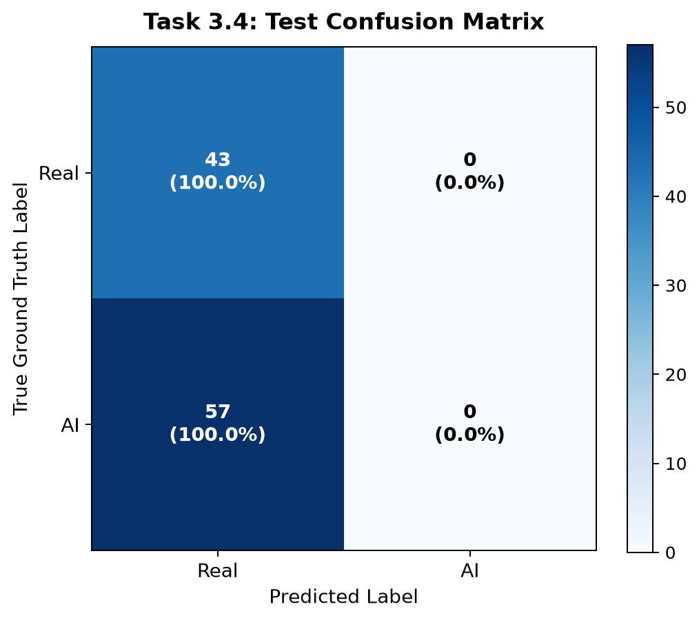
    ```
    *Caption:* Evaluation Confusion Matrix logged as an artifact to DagsHub MLflow.
  - *Figure 3.4b:* Test set ROC Curve artifact
    ```text
    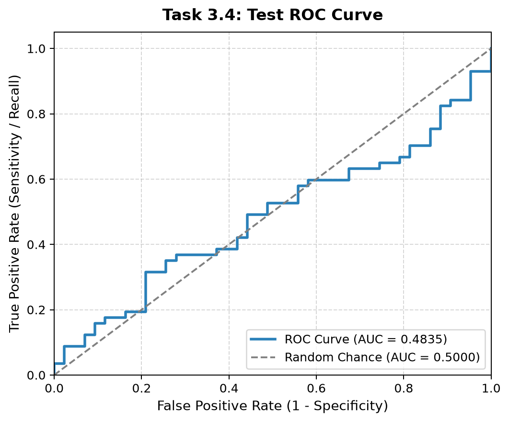
    ```
    *Caption:* Evaluation ROC Curve with AUC metric logged as an artifact to DagsHub MLflow.
  - *Figure 3.4c:* DagsHub MLflow artifact explorer
    ```text
    
    ```
    *Caption:* DagsHub MLflow UI showing all uploaded artifacts (plots, manifests, environment packages, and serialized model).

### Subtask 3.5: Execution and Tracking of Six Distinct Experiments
- **Objective:** Systematically track, compare, and log six distinct experimental runs in MLflow on DagsHub representing controlled variations (learning rate, data augmentation, image resolution, pre-trained backbone, and unfreezing fine-tuning):
- **Execution Command:**
  ```powershell
  python scripts/run_task3_5_compare.py --train-subsample 300 --val-subsample 100
  ```
- **Six Experiments Summary Table:**
  | Run # | Run Name | Controlled Variation | Learning Rate | Augmentation | Image Size | Backbone | Val Loss | Val Accuracy | MLflow Run ID |
  | :---: | :--- | :--- | :---: | :---: | :---: | :---: | :---: | :---: | :--- |
  | **1** | `Run_1_Baseline_CNN` | Baseline Reference | `1e-3` | True | 224x224 | Scratch | `[TBD]` | `[TBD]` | `[TBD]` |
  | **2** | `Run_2_LR_1e4` | Learning Rate (1e-4 vs 1e-3) | `1e-4` | True | 224x224 | Scratch | `[TBD]` | `[TBD]` | `[TBD]` |
  | **3** | `Run_3_No_Augmentation` | Data Augmentation (False vs True) | `1e-3` | False | 224x224 | Scratch | `[TBD]` | `[TBD]` | `[TBD]` |
  | **4** | `Run_4_Size_128` | Image Resolution (128x128 vs 224x224) | `1e-3` | True | 128x128 | Scratch | `[TBD]` | `[TBD]` | `[TBD]` |
  | **5** | `Run_5_MobileNet_Frozen` | Pre-trained Backbone (Feature Extraction) | `1e-3` | True | 224x224 | MobileNetV2 (Frozen) | `[TBD]` | `[TBD]` | `[TBD]` |
  | **6** | `Run_6_MobileNet_Unfrozen` | Fine-Tuning (Top 30 Layers Unfrozen) | `1e-4` | True | 224x224 | MobileNetV2 (Unfrozen) | `[TBD]` | `[TBD]` | `[TBD]` |

- **Screenshots & Evidence:**
  - *Figure 3.5:* MLflow experiment dashboard with all six runs and comparative parallel coordinates
    ```text
    
    ```
    *Caption:* DagsHub MLflow dashboard comparing hyperparameters and validation metrics across all six experimental runs.

### Subtask 3.6: MLflow Model Registry & Champion Model Delivery
- **Objective:** Establish the model registry workflow, stage the champion model, and implement local caching for server delivery:
  - Search `Task_3_5_Comparison` to identify the top 2 candidate runs by validation accuracy.
  - Register model `VisionGuard_Champion` (Version 1 = 2nd best, Version 2 = Best).
  - Assign the alias `@champion` to Version 2 via `client.set_registered_model_alias()`.
  - Validate model serving by loading via `models:/VisionGuard_Champion@champion` and predicting on a sample image.
  - **Server Delivery Strategy:** Persist the loaded champion model to `models/champion.keras`. This guarantees that the Flask web application and Docker container serve predictions locally with zero network latency, without relying on synchronous DagsHub API calls per inference.
- **Execution Command:**
  ```powershell
  python scripts/run_task3_6_registry.py
  ```
- **Registered Model Metadata Table:**
  | Property | Configured Value | Description |
  | :--- | :--- | :--- |
  | **Registered Model Name** | `VisionGuard_Champion` | Centralized Model Registry identifier |
  | **Version 1 (Challenger)** | Version 1 | Derived from 2nd best validation accuracy run |
  | **Version 2 (Champion)** | Version 2 | Derived from top validation accuracy run |
  | **Assigned Alias** | `@champion` | Points to Version 2 for serving |
  | **Local Server Target** | `models/champion.keras` | Local artifact for containerized serving |
- **Screenshots & Evidence:**
  - *Figure 3.6:* DagsHub MLflow Model Registry dashboard
    ```text
    
    ```
    *Caption:* DagsHub Model Registry UI displaying `VisionGuard_Champion` with Version 1, Version 2, and the `@champion` alias.

---

## Task 4: Flask Web Application

### Subtask 4.1: Flask Core Application and HTML/CSS Interface
- **Objective:** Develop a clean Flask web application with custom HTML/CSS user interface served via Jinja2 templates.
- **Details & Observations:**
  - `[Document Flask application structure, template inheritance, static CSS styling, and responsive layout]`
- **Screenshots & Evidence:**
  - *Figure 4.1:* Flask application interface
    ```text
    
    ```
    *Caption:* Web UI rendered by Flask showing upload interface and navigation bar.

### Subtask 4.2: Image Upload and Prediction Result Routes
- **Objective:** Implement `/upload` route handling user image submissions and `/predict` route returning classification results with confidence scores.
- **Details & Observations:**
  - `[Document file validation (extensions, size limits), image preprocessing integration, and prediction output format]`
- **Screenshots & Evidence:**
  - *Figure 4.2:* Prediction result display
    ```text
    
    ```
    *Caption:* Prediction result screen displaying uploaded image, classification label (AI-Generated vs Real), and confidence score.

### Subtask 4.3: History and Health Check Routes
- **Objective:** Implement `/history` route to display prior classification logs and `/health` route for service status monitoring.
- **Details & Observations:**
  - `[Document route implementations, JSON/HTML response structure, and health endpoint status codes]`
- **Screenshots & Evidence:**
  - *Figure 4.3:* History and health check views
    ```text
    
    ```
    *Caption:* Browser views displaying `/health` status response and `/history` log page.

---

## Task 5: Database Trail

### Subtask 5.1: Database Selection and Audit Trail Schema
- **Objective:** Select and configure the database (e.g., SQLite, PostgreSQL, or Redis) and design the audit trail schema.
- **Database Trail Schema Table:**
  | Column Name | Data Type | Constraints | Description |
  | :--- | :--- | :--- | :--- |
  | `id` | `INTEGER` / `UUID` | Primary Key, Auto-increment | Unique record ID |
  | `filename` | `VARCHAR` | Not Null | Uploaded image filename or hash |
  | `prediction` | `VARCHAR` | Not Null | Predicted label (`AI-Generated` or `Real`) |
  | `confidence` | `FLOAT` | Not Null | Classification confidence percentage / probability |
  | `timestamp` | `DATETIME` | Default CURRENT_TIMESTAMP | Submission timestamp |
  | `status` | `VARCHAR` | Nullable | Request processing status |

### Subtask 5.2: Database Integration with Flask Routes
- **Objective:** Connect the database to Flask, logging every prediction event into the database trail upon inference.
- **Details & Observations:**
  - `[Document database connection handler, insertion queries/ORM transactions, and connection lifecycle management]`
- **Screenshots & Evidence:**
  - *Figure 5.2:* Database record insertion
    ```text
    
    ```
    *Caption:* Terminal/log output confirming successful database record insertion after a classification request.

### Subtask 5.3: Dynamic History Route Population
- **Objective:** Query the database trail to populate the `/history` web page with past prediction records dynamically.
- **Details & Observations:**
  - `[Document database query logic, sorting/filtering by timestamp, and dynamic HTML table rendering]`
- **Screenshots & Evidence:**
  - *Figure 5.3:* Populated history view from database
    ```text
    
    ```
    *Caption:* History page displaying past classification queries dynamically fetched from the database.

---

## Task 6: Docker, Docker Compose, and GitHub Actions

### Subtask 6.1: Dockerfile for the Web Application
- **Objective:** Create a production-ready `Dockerfile` packaging the Flask web application, templates, static assets, and runtime dependencies.
- **Details & Observations:**
  - `[Document base Python image, dependency installation, security practices, port exposure, and entrypoint]`
- **Screenshots & Evidence:**
  - *Figure 6.1:* Docker build log
    ```text
    
    ```
    *Caption:* Docker build output showing successful image layer creation and tagging.

### Subtask 6.2: Docker Compose Multi-Service Setup (`web` and `database`)
- **Objective:** Configure `docker-compose.yml` to orchestrate two connected services: `web` (Flask application) and `database` with volume persistence.
- **Details & Observations:**
  - `[Document service definitions, environment variable management, volume mapping, and container network link]`
- **Screenshots & Evidence:**
  - *Figure 6.2:* Docker Compose multi-service execution
    ```text
    
    ```
    *Caption:* Output of `docker-compose up` displaying simultaneous, healthy startup of `web` and `database` containers.

### Subtask 6.3: Continuous Integration (CI) with GitHub Actions
- **Objective:** Configure a GitHub Actions workflow (`.github/workflows/ci.yml`) to automate code linting, environment setup, and test execution on push/PR.
- **Details & Observations:**
  - `[Document workflow triggers, test runner setup, dependency caching, and build validation steps]`
- **Screenshots & Evidence:**
  - *Figure 6.3:* GitHub Actions CI run
    ```text
    
    ```
    *Caption:* GitHub Actions workflow dashboard showing green passing checks across CI jobs.

---

## Task 7: Public Cloud Deployment of the Model API

### Subtask 7.1: Standalone Model API Service Packaging
- **Objective:** Package the model inference pipeline into an independent, lightweight Model API service tailored for cloud hosting.
- **Details & Observations:**
  - `[Document Model API endpoint structure, payload parsing, model loading, and JSON response schema]`
- **Screenshots & Evidence:**
  - *Figure 7.1:* Model API local verification
    ```text
    
    ```
    *Caption:* Terminal/Postman test verifying Model API functionality locally prior to cloud deployment.

### Subtask 7.2: Public Cloud Deployment
- **Objective:** Deploy the Model API service to a publicly accessible cloud hosting provider (e.g., Render, Railway, Hugging Face Spaces, or Cloud VM).
- **Details & Observations:**
  - `[Document chosen cloud provider, deployment configuration, environment variables, and live endpoint URL]`
- **Screenshots & Evidence:**
  - *Figure 7.2:* Public cloud deployment dashboard
    ```text
    
    ```
    *Caption:* Cloud hosting dashboard confirming active deployment and healthy status of the hosted Model API.

### Subtask 7.3: Live Cloud Model API Testing
- **Objective:** Test and verify the publicly deployed Model API with remote HTTP requests.
- **Details & Observations:**
  - `[Document public URL, curl/Postman test commands, inference latency, and response JSON validation]`
- **Screenshots & Evidence:**
  - *Figure 7.3:* Live cloud API request and response
    ```text
    
    ```
    *Caption:* Live query to the public cloud Model API showing successful inference output.

---

## Task 8: Flask/API Integration and End-to-End Testing

### Subtask 8.1: Connecting Flask Web Application to the Hosted Model API
- **Objective:** Configure the Flask web application to dispatch image inference requests to the public cloud hosted Model API.
- **Details & Observations:**
  - `[Document HTTP client implementation, request timeouts, image serialization, and error recovery]`
- **Screenshots & Evidence:**
  - *Figure 8.1:* Flask application remote API communication log
    ```text
    
    ```
    *Caption:* Application logs showing Flask receiving an upload and querying the public cloud Model API.

### Subtask 8.2: Recording External API Responses into Database Trail
- **Objective:** Ensure all responses and prediction metadata returned by the hosted cloud Model API are systematically stored in the database trail.
- **Details & Observations:**
  - `[Document database write verification, response logging, latency recording, and database query verification]`
- **Screenshots & Evidence:**
  - *Figure 8.2:* Database trail verification with hosted API data
    ```text
    
    ```
    *Caption:* Database query showing logged prediction records originating from the public cloud Model API.

### Subtask 8.3: End-to-End System Verification & Final Submission Checklist
- **Objective:** Perform end-to-end user testing: User Upload -> Flask -> Cloud Model API -> Database Trail -> History Display.
- **Screenshots & Evidence:**
  - *Figure 8.3:* End-to-end system execution
    ```text
    
    ```
    *Caption:* Complete workflow verification demonstrating successful classification, database record, and history view.

- **Final Submission Checklist:**

| Item | Requirement Description | Verification Status | Notes |
| :--- | :--- | :---: | :--- |
| **Code Repository** | GitHub repository is accessible, clean, and properly structured | [ ] | |
| **Task 1: Environment & EDA** | Dataset audit (`cashbowman`), visual EDA, and DVC tracking complete | [ ] | |
| **Task 2: Modeling** | Custom CNN + Transfer Learning + Keras Tuner + Evaluation complete | [ ] | |
| **Task 3: MLflow Tracking** | 6 distinct experiments logged to DagsHub MLflow + Model Registry | [ ] | |
| **Task 4: Flask App** | Flask web app with HTML/CSS interface and required routes | [ ] | |
| **Task 4 Routes** | `/upload`, `/predict`, `/history`, and `/health` functional | [ ] | |
| **Task 5: Database Trail** | Database connected to Flask, logging every prediction event | [ ] | |
| **Task 6: Docker Compose** | Docker Compose running two services (`web` and `database`) | [ ] | |
| **Task 6: CI Workflow** | GitHub Actions CI workflow passing cleanly | [ ] | |
| **Task 7: Cloud Model API** | Model API deployed to public cloud and responding to requests | [ ] | |
| **Task 8: Integration** | Flask web app queries hosted Model API and stores trail in DB | [ ] | |
| **Report Document** | All sections, metrics tables, and figure captions completed | [ ] | |
